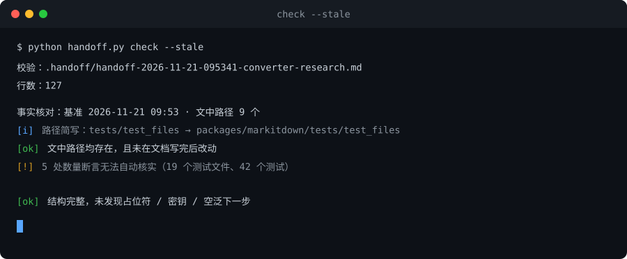

# task-handoff

> 把一个阶段压成一个文件，让下一个窗口零成本接手。

A skill for AI coding agents: compress a work phase into one self-contained handoff document, so the next session can start working without re-reading thousands of lines of chat history.

---

## 它解决什么

跟 AI 一起写代码，最贵的一次浪费不是写错，是**换窗口**：

新会话不知道上次做到哪、为什么这么设计、哪些坑已经踩过。于是它重读全部代码、重问一遍需求，甚至把你已经否掉的方案重新提一遍。

`task-handoff` 把这个过程固化成一套流程：**先取证，再写一份自包含的交接文档，最后机械校验**。

| 问题 | 没有它 | 有它 |
|---|---|---|
| 换窗口 | 重新讲一遍背景 | 读一份文档 |
| 技术栈漂移 | 新会话装了重复依赖、换了框架 | 第 4 节写死契约与禁区 |
| 重复踩坑 | 同一个坑踩两次 | 第 6 节记着「现象 → 原因 → 正确做法」 |
| 假账 | 写「已完成」，其实没验证 | 第 8 节强制写验证方式，没验就标「未验证」 |
| 决策被推翻 | 新会话重新提已否掉的方案 | 第 5 节写「放弃了什么」，并标来源 |

## 看效果



在 [`microsoft/markitdown`](https://github.com/microsoft/markitdown)（197k star）上生成的第 6 节节选：

> - **priority 有两条并存规则，极易搞反**：注释写明「数字越小越先试」，同时另一处写明「后注册的优先于先注册的」。加转换器时既要挑对 priority 常量，也要注意注册顺序的影响，不能只改一个
> - `accepts()` 返回 True 就**意味着** `convert()` 必须能处理它，且要保证读完把 stream 位置复原
> - monorepo 根目录**没有** `pyproject.toml`，在根目录执行 `pip install -e .` 会直接失败

这三条在项目官方 README（475 行）里**一次都没出现过**——它们藏在代码注释和目录结构里。这正是交接文档该抓的东西：**官方文档讲「怎么用」，交接文档讲「改的时候哪里会咬人」**。

更多真实产出见 [`examples/`](examples/)。

## 安装

**作为 skill**：把本目录放到 skill 目录下即可。

```bash
git clone https://github.com/lunzzz49/task-handoff.git ~/.workbuddy/skills/task-handoff
```

WorkBuddy / CodeBuddy 会自动读取 `SKILL.md`。其它支持 `SKILL.md` 规范的客户端同理（Claude Code 用 `~/.claude/skills/task-handoff`）。若目标目录已存在，先删掉或改用 `git pull`。

**依赖**：Python 3.9+，**零第三方库**——skill 本身只用标准库。仓库里的 `.github/scripts/build_pages.py` 需要 `markdown`，但那只在 CI 里跑，本地用不到。

**验证安装**：

```bash
python ~/.workbuddy/skills/task-handoff/tests/test_handoff.py
# Ran 90 tests ... OK
```

Windows 上若 `python` 不可用，试 `py`。

## 用法

### 写一份交接

```bash
# 先把 skill 里的脚本路径记下来（按你的实际安装位置改）
export HANDOFF=~/.workbuddy/skills/task-handoff/scripts/handoff.py

# 1. 在项目根建骨架
python "$HANDOFF" new --slug phase-2

# 2. 填十节 —— 由 AI 按 SKILL.md 的流程填，不是人手工写

# 3. 机械校验 + 事实核对
python "$HANDOFF" check --stale
```

### 读一份交接

```bash
python "$HANDOFF" latest   # 拿最新一份的绝对路径
```

如果最新一份是刚建还没填的空骨架，`latest` 会警告并给出上一份——避免新会话把空文档当真。

### 命令一览

| 命令 | 作用 |
|---|---|
| `new` | 建交接文档骨架，`--inherit` 可从上一份继承技术栈与红线 |
| `latest` | 定位最新一份（会提示空骨架并指向上一条） |
| `check` | 结构校验；加 `--stale` 核对文中路径是否真存在、写完后是否被改过 |
| `log` | 追加一条进展（自动带 6 位短 ID） |
| `journal` | 列出所有进展条目 |
| `undo` | 按 ID 撤销（`--id`），或撤销最后一条 |
| `restore` | 回滚到最近一次写入前的快照 |
| `summarize` | 把旧进展归档到附录，时间线只留活跃条目 |

### 可选：自动提醒

第四节「收尾兜底」原本靠 AI 记得自查。挂上事件入口后，说「收工 / 换个窗口 / 交接」会注入一句提醒，测试跑通会自动记一条进展。

```bash
python scripts/install_hooks.py    # Claude Code；其它客户端见 references/integration.md
```

入口的契约只有一条：**事件发生时执行命令，stdin 传事件，stdout 读结果，空输出等于不打扰**。所以不限于 Claude Code，自建 agent 也能接。

刻意做窄：没有 `.handoff/` 就完全不说话，同一条 10 分钟内不重复记，只认测试通过这一种确定性事实。**不装不影响任何功能**，手动流程本来就是完整的。

## 它凭什么可信

### 三层分工，各管一件事

| 目录 | 管什么 |
|---|---|
| `SKILL.md` | **流程**：什么时候做什么，每步指向哪个文件 |
| `references/` | **标准**：什么算合格——判据、模板、自检清单 |
| `scripts/` | **工具**：确定性且会反复执行的机械动作 |

流程写进标准会僵化，标准写进脚本会散架。分开之后，改判据不用碰代码，改代码不用碰判据。

### 自检七问

写完后逐条打勾，机械项交给 `check`，人判项自己看。第一问就是：

> 「下一步第一步」是不是一个新会话**五分钟内就能直接执行**的具体动作？
> ❌ 「继续完善导出功能」
> ✅ 「在 `export.py:42` 补 xlsx 分支，跑 `pytest tests/test_export.py -k xlsx`」

### 事实与推断分开

第 5 节「关键决策」表强制带**来源**列：

| 来源 | 可信度 |
|---|---|
| `代码注释` / `README` / `docs` | 高 |
| `git log` / `PR` | 中高 |
| `推断` | **低，必须显式标出** |

从代码结构反推出来的理由是判断，不是项目立场。不标出来，下一个人会拿它当依据。

### 完备性按项目分级

不是每个项目都有官方文档。动笔前先判档：

| 项目类型 | 交接文档的角色 |
|---|---|
| 有官方文档（README + CONTRIBUTING + docs） | 补充层：只写官方永远不写的隐性契约，用法指路 |
| 只有零散记录（自研项目 + README/DECISIONS） | 主文档：补齐缺口，设计理由自己写清 |
| 完全没有文档 | **唯一信息源**：安装/运行/测试/理由全部写全，不许「见某文件」 |

### 有一说一：`check` 查不了什么

它能查结构完整、占位符残留、明文密钥、篇幅越界、路径是否存在、文档写完后有没有被改动。

**它查不了数字对不对**。文档写「19 个测试文件」，`check` 只能提醒你去数——`--stale` 会输出「N 处数量断言无法自动核实」。这条是踩过坑才加的：曾经把 19 个写成 21 个（把 `__init__.py` 算进去了），工具全程 `[ok]`。

## 实测覆盖

在 8 个开源项目上生成并校验，全部通过：

| 项目 | 语言 | 类型 |
|---|---|---|
| microsoft/markitdown (197k★) | Python | monorepo 工具 |
| sharkdp/bat (61k★) | Rust | 库 + CLI 双入口 |
| google/guava (52k★) | Java | Maven 多模块 |
| nlohmann/json (51k★) | C++ | header-only，五套构建 |
| square/okhttp (47k★) | Kotlin | Gradle 复合构建 |
| charmbracelet/bubbletea (46k★) | Go | 单包扁平 |
| modelcontextprotocol/python-sdk (25k★) | Python | 官方 SDK，根级 AGENTS.md |
| App-vNext/Polly (14k★) | C# | .NET，v8 重写 |

覆盖 7 门语言、8 到 3353 文件的项目规模，以及从「只有 README」到「578 行规范文档」的文档完备度差异。

> 以上项目名称与商标归各自所有者。这些文档是对应项目的**第三方技术分析**，与各项目维护者无关联、未获其背书，也不包含其源代码，不重新分发其代码。详见 [`examples/README.md`](examples/README.md)。

## 已知边界

- **路径提取会误判**：长得像路径但不是文件的写法（HTTP 路由、Go module path、`chrome://`、XML 标签）已逐步排掉，但新形态仍可能出现。`--stale` 是辅助核对，不是真理。
- **不替代项目文档**：它产出的是「接手决策书」，不是「项目说明书」。项目有自己的 README 时，别指望交接文档复述用法。
- **依赖 AI 执行流程**：`SKILL.md` 是给 agent 读的指令，人自己照着做会觉得步骤偏多。

## License

[MIT](LICENSE) © 2026 Lunq
